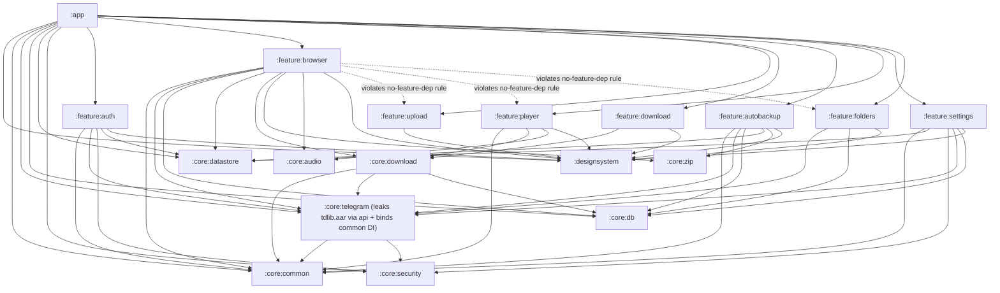
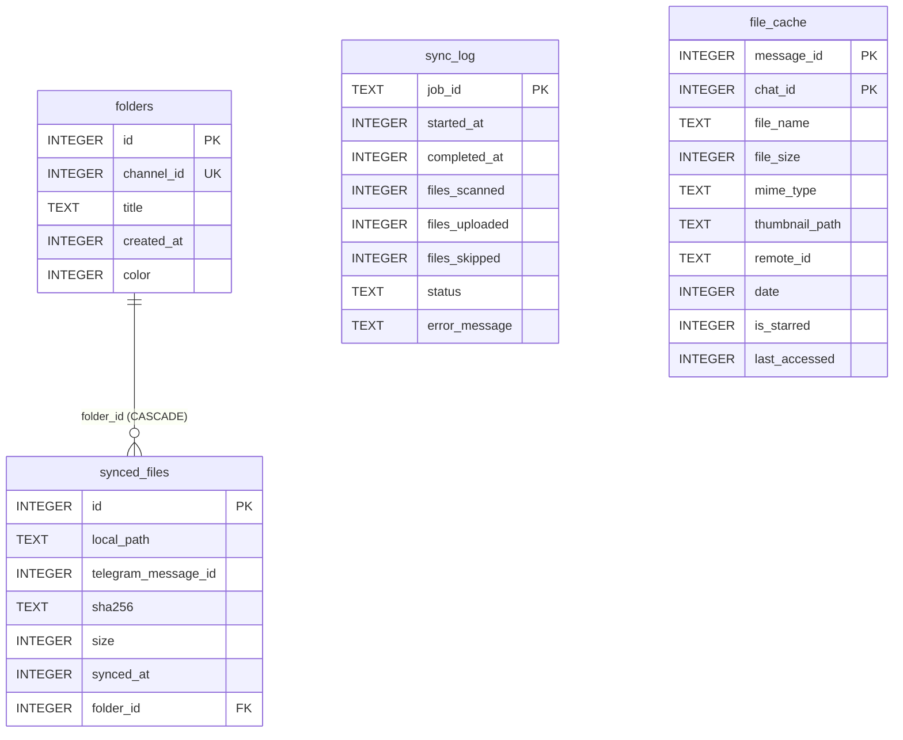
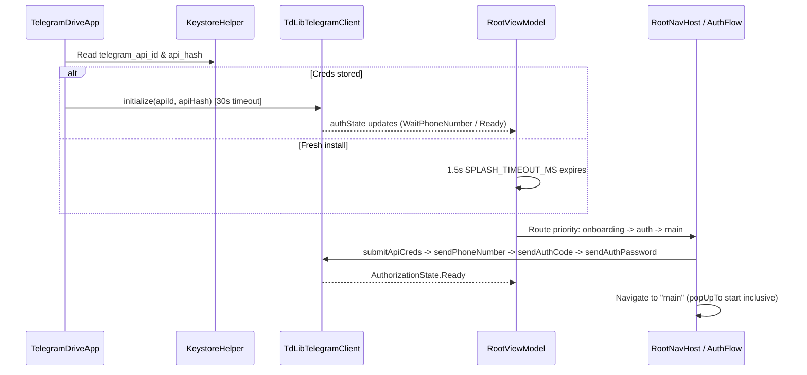
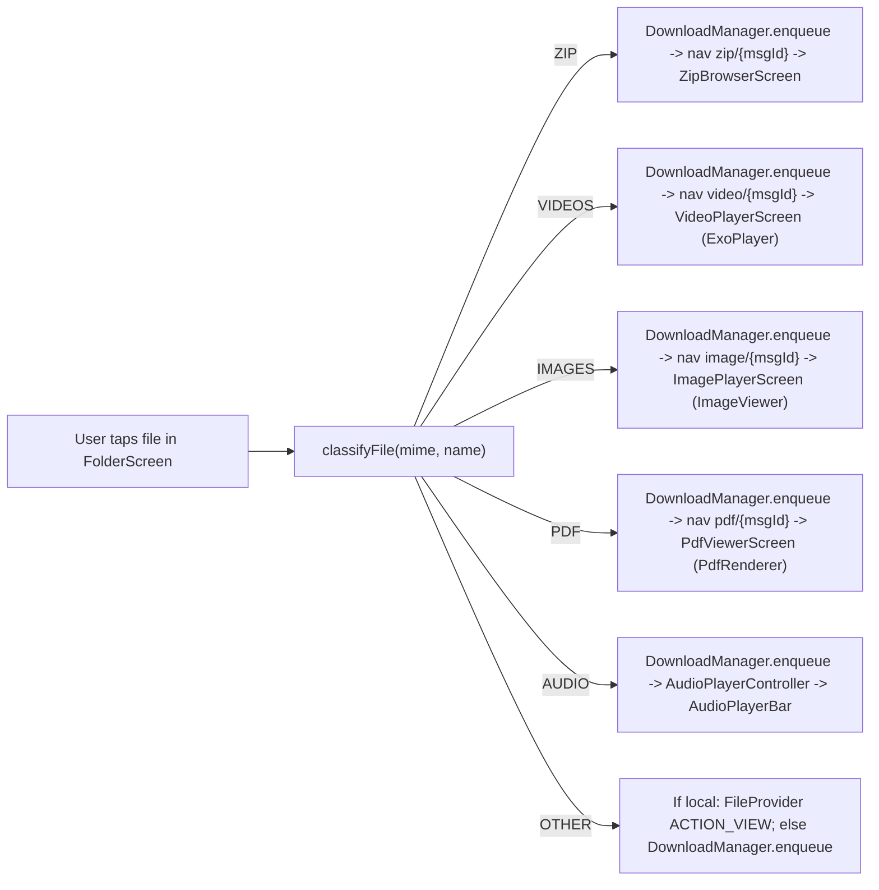
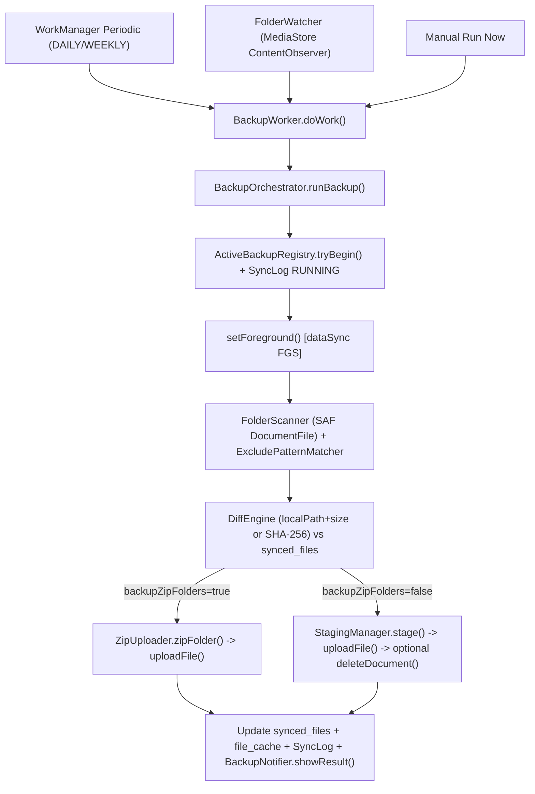

# Telegram Drive (Android) — Complete Codebase Documentation

> **Audited codebase:** `/workspace/TelegramDrive-Android`  
> **App ID:** `com.tgdrive.app` · **Build version:** `versionCode = 1`, `versionName = "1.0.3"` (see [Version Drift](#12-version--documentation-drift))  
> **Scope:** All 18 Gradle modules (`:app`, `:designsystem`, 8 `:core:*`, 8 `:feature:*`), build/CI configuration, ProGuard/R8 rules, tests, and existing documentation.

---

## 1. Overview & Tech Stack

**Telegram Drive** turns Telegram (Saved Messages and user-created private channels) into a zero-cost cloud drive on Android (up to 2 GB per file via Telegram MTProto/TDLib), paired with a WorkManager-backed **AutoBackup** engine, an in-app **ZIP browser**, media viewers/players, storage analytics, and an Android **Storage Access Framework (SAF)** `DocumentsProvider`.

### 1.1 Tech Stack & Versions

| Layer | Technology / Version | Source |
|---|---|---|
| Language | Kotlin `2.1.10`, JVM `17` | `gradle/libs.versions.toml:3`, `app/build.gradle.kts:58-63` |
| Android Gradle Plugin | AGP `8.5.2`, `compileSdk = 35`, `targetSdk = 35`, `minSdk = 26` | `gradle/libs.versions.toml:2`, `app/build.gradle.kts:11-16` |
| Annotation Processing | KSP `2.1.10-1.0.31` (`ksp.useKSP2=true`) | `gradle/libs.versions.toml:4`, `gradle.properties:16` |
| UI Toolkit | Jetpack Compose (BOM `2024.09.03`), Material 3, Navigation Compose `2.8.1` | `gradle/libs.versions.toml:8,12` |
| Dependency Injection | Hilt `2.56.2`, Hilt Navigation Compose `1.2.0`, Hilt Work `1.2.0` | `gradle/libs.versions.toml:5-7` |
| Async | Kotlinx Coroutines `1.9.0` + `Flow` / `StateFlow` | `gradle/libs.versions.toml:13` |
| Persistence | Room `2.7.0` (schema `v3`), Preferences DataStore `1.1.1` | `gradle/libs.versions.toml:14-15` |
| Security | `androidx.security:security-crypto:1.1.0-alpha06`, `androidx.biometric:1.2.0-alpha05` | `gradle/libs.versions.toml:20-21` |
| Background Work | WorkManager `2.9.1` (`CoroutineWorker` + `HiltWorkerFactory`) | `gradle/libs.versions.toml:16` |
| Media & Images | Media3 ExoPlayer `1.4.1`, Android `MediaPlayer`, `PdfRenderer`, Coil `2.7.0` | `gradle/libs.versions.toml:17-18` |
| Archives | `net.lingala.zip4j:zip4j:2.11.5` + `java.util.zip` | `gradle/libs.versions.toml:23` |
| Telegram Client | Prebuilt TDLib `1.8.65` (`core/telegram/libs/tdlib.aar`, 92.6 MB `.so` across 4 ABIs) | `core/telegram/build.gradle.kts:31-37` |
| Testing & Lint | JUnit 5 `5.11.0` (+ Vintage engine), MockK `1.13.12`, Robolectric `4.13`, Turbine `1.1.0`, Truth `1.4.4`, ktlint `12.1.1` (`1.3.1`) | `gradle/libs.versions.toml:24-37,133`, `build.gradle.kts:18-24` |

### 1.2 Version & Documentation Drift

- `app/build.gradle.kts:17-18` still sets `versionCode = 1` and `versionName = "1.0.3"`, while `SettingsScreen.kt:185` and `AboutScreen.kt:68` hardcode `"1.0.3"`, and `TdLibTelegramClient.kt:161,256` reports `"1.0.0"` / `"1.0.1"` to TDLib. Meanwhile `docs/CHANGELOG.md` and `docs/HANDOFF.md` describe releases `v2.0.0` through unreleased `v2.1.2`.
- `gradle/libs.versions.toml:19,102-103` and `settings.gradle.kts:22` still declare unused `tdlight` artifacts and `mvn.mchv.eu`, even though `:core:telegram` now bundles `core/telegram/libs/tdlib.aar` (`org.drinkless.tdlib`).

---

## 2. Module Architecture & Dependency Graph

Although `CONTRIBUTING.md` and `docs/ARCHITECTURE.md` state that `:feature:*` modules never depend on each other, **`feature/browser/build.gradle.kts:40-42` currently depends directly on `:feature:upload`, `:feature:player`, and `:feature:folders`**. Furthermore, `:core:telegram` exposes `tdlib.aar` via `api(...)` (`core/telegram/build.gradle.kts:37`) and binds `:core:common`'s `DispatchersProvider` and `NetworkMonitor` inside `TelegramModule` (`TelegramModule.kt:27-34`).

### 2.1 Complete 18-Module Inventory

| Module | Namespace | Responsibilities | Key Classes / Symbols | Unit / UI Tests |
|---|---|---|---|---|
| `:app` | `com.tgdrive.app` | Application bootstrap, `MainActivity`, `RootNavHost`, `MainBottomNav`, `OnboardingScreen`, `BootCompletedReceiver`, `NotificationChannels` | `TelegramDriveApp`, `MainActivity`, `RootViewModel`, `RootNavHost`, `MainBottomNav`, `OnboardingViewModel` | 0 unit / 1 test runner (`HiltTestRunner`) |
| `:designsystem` | `com.tgdrive.designsystem` | Theme, colors, typography, shapes, glass surfaces, editorial rows/cards, `ConcentricPulse`, `StoragePieChart` | `TgColors`, `FileTypeTints`, `TelegramDriveTheme`, `TgTypography`, `TgShapes`, `GlassPanel`, `EditorialComponents` | 0 |
| `:core:common` | `com.tgdrive.core.common` | Coroutine dispatchers, formatting/regex extensions, canonical `FileBucket`, logger, network monitor, PiP controller | `DispatchersProvider`, `FileBucket`, `classifyFile`, `Log`, `NetworkMonitor`, `PipController` | 2 unit files (`ExtensionsTest`, `PipControllerTest` failing on JVM) |
| `:core:telegram` | `com.tgdrive.core.telegram` | TDLib v1.8.65 JNI client wrapper, auth state machine, folder/message/transfer APIs, Hilt bindings | `TelegramClient`, `TdLibTelegramClient`, `AuthorizationState`, `TelegramMessage`, `TelegramModule` | 1 unit file (`TelegramClientTest`) |
| `:core:db` | `com.tgdrive.core.db` | Room v3 database (`tgdrive.db`), 4 entities, 4 DAOs, v1→v2 & v2→v3 migrations | `TgDriveDatabase`, `DatabaseModule`, `FileCacheDao`, `FolderDao`, `SyncedFileDao`, `SyncLogDao` | 1 unit file (`TgDriveDatabaseTest`) |
| `:core:datastore` | `com.tgdrive.core.datastore` | Preferences DataStore (`tgdrive_prefs`) holding 23 UI, cache, backup, and scheduled upload preferences | `AppPreferences`, `AppPreferencesData`, `ThemeMode`, `BackupSchedule`, `FileViewMode`, `FileFilter`, `FileSort`, `ConflictStrategy` | 1 unit file (`AppPreferencesDataTest`) |
| `:core:security` | `com.tgdrive.core.security` | `EncryptedSharedPreferences` + Keystore master key + Knox fallback, TDLib 32-byte key, `BiometricPrompt` wrapper | `KeystoreHelper`, `BiometricHelper` | 0 |
| `:core:download` | `com.tgdrive.core.download` | In-memory download queue (`Semaphore(2)`), progress notification, exported SAF `DocumentsProvider` | `DownloadManager`, `DownloadItem`, `DownloadStatus`, `TelegramDocumentsProvider` | 0 |
| `:core:zip` | `com.tgdrive.core.zip` | Folder ZIP creation (plain + zip4j AES-256), extraction, entry listing | `ZipUploader`, `ZipEntryInfo` | 0 |
| `:core:audio` | `com.tgdrive.core.audio` | Singleton `android.media.MediaPlayer` wrapper + playback state flow | `AudioPlayerController`, `AudioState` | 0 |
| `:feature:auth` | `com.tgdrive.feature.auth` | 5-step Telegram login flow (API creds → phone → OTP → 2FA → Done) | `AuthViewModel`, `AuthFlow`, `AuthStep`, `AuthState` | 0 unit / 1 placeholder `androidTest` |
| `:feature:browser` | `com.tgdrive.feature.browser` | Home bento dashboard, folder explorer, file actions/move/details, global search, ZIP browser, storage analytics | `HomeScreen`, `FolderScreen`, `FoldersManagementScreen`, `GlobalSearchScreen`, `ZipBrowserScreen`, `StorageAnalyticsScreen`, `FileDetailsSheet`, `MoveTargetPickerDialog`, `ZipThumbnailGenerator`, `ExtractedFileRouter`, `BrowserModule`, `StorageAnalytics` | 6 unit files (1 tests copy-pasted code) / 1 placeholder `androidTest` |
| `:feature:upload` | `com.tgdrive.feature.upload` | ZIP upload naming & AES-256 encryption options dialog | `ZipUploadOptionsDialog` | 0 |
| `:feature:download` | `com.tgdrive.feature.download` | Transfer queue UI (Active & Completed download tabs) | `DownloadListScreen`, `DownloadListViewModel` | 0 |
| `:feature:folders` | `com.tgdrive.feature.folders` | Folder CRUD ViewModel & sheets/dialogs | `FolderEditorViewModel`, `CreateFolderSheet`, `RenameFolderSheet`, `DeleteFolderDialog` | 0 |
| `:feature:autobackup` | `com.tgdrive.feature.autobackup` | WorkManager backup pipeline, SAF scanner, MediaStore watcher, SHA-256 diff engine, staging, notifications, history UI | `BackupOrchestrator`, `BackupWorker`, `BackupScheduler`, `FolderScanner`, `FolderWatcher`, `DiffEngine`, `ExcludePatternMatcher`, `StagingManager`, `ActiveBackupRegistry`, `BackupNotifier`, `BackupActionReceiver`, `AutoBackupViewModel`, `AutoBackupScreen`, `BackupHistoryScreen`, `SyncLogDetailsScreen` | 4 unit files |
| `:feature:player` | `com.tgdrive.feature.player` | ExoPlayer video player + PiP, persistent audio bar, pinch-zoom image viewer, `PdfRenderer` PDF viewer | `VideoPlayerScreen`, `VideoPlayerViewModel`, `AudioPlayerBar`, `AudioPlayerScaffold`, `ImagePlayerScreen`, `ImageViewer`, `PdfViewerScreen` | 0 |
| `:feature:settings` | `com.tgdrive.feature.settings` | Theme, cache limit slider, biometric lock toggle, API info, logout wipe, unwired cache/about screens | `SettingsViewModel`, `SettingsScreen`, `CacheSettingsScreen`, `AboutScreen` | 0 |

---

## 3. App Entrypoints, Lifecycle & Navigation (`:app`)

### 3.1 `TelegramDriveApp` (`app/src/main/java/com/tgdrive/app/TelegramDriveApp.kt`)
- `@HiltAndroidApp`, implements `Configuration.Provider` (supplies `HiltWorkerFactory` to WorkManager after `WorkManagerInitializer` is removed in `AndroidManifest.xml:80-89`) and Coil `ImageLoaderFactory` (memory cache 25%, disk cache `cacheDir/image_cache` capped at 50 MB, crossfade enabled, `L161-175`).
- `onCreate()` ensures notification channels (`L54`) and launches 3 parallel tasks on `appScope = CoroutineScope(SupervisorJob() + Dispatchers.IO)`:
  1. **TDLib Auto-Init (`L84-107`)**: Reads `telegram_api_id` / `telegram_api_hash` directly from `keystoreHelper.encryptedPrefs` and runs `telegramClient.initialize(..., "tgdrive_tdlib")` inside `withTimeoutOrNull(30_000L)`.
  2. **Crash Recovery (`L111-118`)**: Calls `syncLogDao.markRunningAsCancelled(now)` so any `RUNNING` job interrupted by process death becomes `CANCELLED`.
  3. **AutoBackup Bootstrap (`L122-138`)**: Reads `preferences.data.first()`; if `backupEnabled && !backupPaused && backupSchedule == BackupSchedule.ON_CHANGE`, calls `startFolderWatcher()`, then calls `backupScheduler.rescheduleIfEnabled()`.

### 3.2 `MainActivity` (`app/src/main/java/com/tgdrive/app/MainActivity.kt`)
- Extends `FragmentActivity` (required by `BiometricPrompt`), calls `installSplashScreen()`, `enableEdgeToEdge()`, and renders `TelegramDriveTheme(darkTheme)` → `OfflineBanner` + `RootNavHost` + conditional `BiometricGate` overlay (`L54-103`).
- **Share-to-App (`L66-68`)**: Forwards `intent` inside `LaunchedEffect(intent)` to `rootVm.handleShareIntent(it)` (Note: `MainActivity` lacks `onNewIntent`).
- **PiP (`L116-121`)**: `onUserLeaveHint()` checks `pipController.shouldEnterPip()` and invokes `pipController.enterPip(this)`.
- **Biometric Lock (`L51-52, 106-109, 123-190`)**: `onStop()` records `backgroundedAtMs = SystemClock.elapsedRealtime()`; `onStart()` activates `biometricGateActive = true` if elapsed `> 60_000L` ms and `biometricHelper.availability() == AVAILABLE`.

### 3.3 `RootViewModel`, `RootNavHost` & `MainBottomNav`
- **`RootViewModel` (`app/src/main/java/com/tgdrive/app/RootViewModel.kt`)**:
  - Combines `telegramClient.authState`, `preferences.data`, `networkMonitor.isOnline`, a 1500 ms `SPLASH_TIMEOUT_MS` timer (`L152-158`), and `checkStoredCreds()`.
  - Handles `ACTION_SEND` / `ACTION_SEND_MULTIPLE` URIs (`handleShareIntent`, `confirmShareUpload`, `cancelShareUpload`) by staging `content://` streams into `cacheDir/share_staging` and uploading to `telegramClient.myUserId()`.
- **`RootNavHost` (`app/src/main/java/com/tgdrive/app/nav/RootNavHost.kt`)**:
  - Displays a centered `CircularProgressIndicator` while `state.isInitializing` is `true` (≤1.5 s).
  - Single `LaunchedEffect(targetRoute)` routes between `"onboarding"`, `"auth"`, and `"main"` (`NavHost` starts on `"auth"`).
  - Wraps `"main"` inside `AudioPlayerScaffold { MainBottomNav(...) }`.
  - Pushes full-screen routes onto the root `NavHost`: `"history"`, `"synclog/{jobId}"`, `"video/{msgId}"`, `"pdf/{msgId}"`, `"image/{msgId}"`, `"zip/{msgId}"`, `"downloads"`.
- **`MainBottomNav` (`app/src/main/java/com/tgdrive/app/nav/MainBottomNav.kt`)**:
  - Custom 64dp bottom bar `Row` (`TgColors.Surface.copy(alpha = 0.85f)`) with 5 tabs and an active 4dp dot indicator:
    - `Tab.HOME` (`"tab/home"`, label `"Files"`) → `HomeScreen`
    - `Tab.FOLDERS` (`"tab/folders"`, label `"Folders"`) → `FoldersManagementScreen`
    - `Tab.TRANSFERS` (`"tab/transfers"`, label `"Transfers"`) → `DownloadListScreen`
    - `Tab.BACKUP` (`"tab/backup"`, label `"Backup"`) → `AutoBackupScreen`
    - `Tab.SETTINGS` (`"tab/settings"`, label `"Settings"`) → `SettingsScreen`
  - Nested routes inside `MainBottomNav`: `"analytics"`, `"search"`, `"folder/{chatId}/{title}"`.
  - Hosts `ShareUploadDialog` when `rootState.pendingShareUris` is non-empty (**Note:** calls `hiltViewModel()` inside `"main"`, creating a different `RootViewModel` instance than `MainActivity`).

### 3.4 Manifest, Boot, Channels & Onboarding
- **`AndroidManifest.xml`**: Declares `INTERNET`, `ACCESS_NETWORK_STATE`, `FOREGROUND_SERVICE`, `FOREGROUND_SERVICE_DATA_SYNC`, `POST_NOTIFICATIONS`, `READ_MEDIA_{IMAGES,VIDEO,AUDIO}`, `READ_EXTERNAL_STORAGE (maxSdk 32)`, `MANAGE_MEDIA`, `RECEIVE_BOOT_COMPLETED`, `USE_BIOMETRIC`, `USE_FINGERPRINT`, `WAKE_LOCK`; `allowBackup="false"`, `enableOnBackInvokedCallback="true"`. Registers `MainActivity` (`MAIN`/`LAUNCHER`, `SEND`/`SEND_MULTIPLE`), `FileProvider` (`${applicationId}.fileprovider` mapped via `res/xml/file_paths.xml`), `SystemForegroundService (dataSync)`, `BootCompletedReceiver`, `BackupActionReceiver`, and exported `TelegramDocumentsProvider` (`MANAGE_DOCUMENTS`).
- **`BootCompletedReceiver` (`app/.../boot/BootCompletedReceiver.kt`)**: Uses `goAsync()` + IO coroutine to call `backupScheduler.rescheduleIfEnabled()` on `BOOT_COMPLETED` / `MY_PACKAGE_REPLACED`.
- **`NotificationChannels` (`app/.../boot/NotificationChannels.kt`)**: Creates `backup.progress` (`IMPORTANCE_LOW`), `backup.result` (`IMPORTANCE_DEFAULT`), `download.progress` (`IMPORTANCE_LOW`), `upload.progress` (`IMPORTANCE_LOW` — unused).
- **`OnboardingScreen` (`app/.../onboarding/OnboardingScreen.kt`)**: 4-slide `HorizontalPager` with `OnboardingViewModel.complete()` persisting `onboardingCompleted = true`.

---

## 4. Design System (`:designsystem`)

The codebase currently mixes **three overlapping UI eras**:
1. **Deep Space Terminal** (`app/res/values/colors.xml`): `#0A0D14` root, `#161C2D` card, `#2D8CF0` blue, `#00C9B1` teal, `#F5A623` amber.
2. **Editorial Magazine** (`designsystem/editorial/`): `TgColors.Card`, `EditorialHeader`, `HeroNumber`, `CalloutCard`, `SuccessCallout`, `SectionLabel`, `EditorialCard`, `MiniStat`, `EditorialListItem`, `EditorialSwitchRow`, `EditorialEmptyState`, `EditorialProgressRow`, `EditorialKeyValueRow`, `EditorialRadioRow`.
3. **MD3 Expressive "Deep Navy + Amber" Glassmorphism** (`Color.kt`, `Shapes.kt`, `GlassPanel.kt`): `#031524` background/surface, `#FFD395` amber primary, `#9DCAFF` secondary, `#66F3B6` tertiary, `#FFB4AB` error, `GlassPanel`, `TintedGlassPanel`, `StoragePieChart`.

### 4.1 Token Summary
- **`TgColors` (`Color.kt`)**: `Background = 0xFF031524`, `Surface = 0xFF031524`, `SurfaceContainer = 0xFF102131` (aliased as `Card`), `SurfaceContainerHighest = 0xFF263647`, `GlassPanel = 0x66263647` (40% alpha despite doc comment claiming 70%), `Primary = 0xFFFFD395`, `OnPrimary = 0xFF442B00`, `Secondary = 0xFF9DCAFF` (aliased `AccentBlue`), `Tertiary = 0xFF66F3B6` (aliased `AccentTeal`/`Success`), `Error = 0xFFFFB4AB` (aliased `ErrorRed`), `TextPrimary = 0xFFD3E4FA`, `TextMuted = 0xFF9F8E78`, `OnSurfaceVariant = 0xFFD7C4AC`, plus `Light*` tokens.
- **`TelegramDriveTheme` (`Theme.kt`)**: Animates `MaterialTheme.colorScheme` transitions (300 ms) between `DarkColorScheme` and `LightColorScheme` (`primary = TgColors.AccentBlue`, `onPrimary = TgColors.TextPrimary`/`LightTextPrimary`), though almost every screen bypasses `MaterialTheme.colorScheme` and hardcodes `TgColors.*`.
- **`TgTypography` (`Typography.kt`)**: Uses `FontFamily.Default` and `FontFamily.Monospace` (Inter/JetBrains Mono TTFs not bundled yet), `displayLarge` 32sp down to `bodySmall` 11sp, `Mono` 13sp, `Caption` 11sp.
- **`TgShapes` (`Shapes.kt`)**: `Small` 4dp, `Medium` 8dp, `Large` 12dp, `XLarge` 16dp, `XXLarge` 24dp, `BottomSheet` top 24dp.
- **`ConcentricPulse` (`ConcentricPulse.kt`)**: `Canvas` animated rings with solid center core used in `AuthFlow` and `AutoBackupScreen`.

---

## 5. Core Modules Reference (`:core:*`)

### 5.1 `:core:common`
- **`DispatchersProvider` / `DefaultDispatchersProvider`** (`DispatchersProvider.kt`): Exposes `io`, `default`, `main` (bound in `:core:telegram`'s `TelegramModule`).
- **`Extensions.kt`**: `Long.toHumanSize()`, `Long.toIsoUtc()`, `Long.toLocalShort()`, `String.ellipsize(max)`, `String.isE164()` (`^\+?[1-9]\d{6,14}$`), `tryNull(block)`.
- **`FileBucket.kt`**: `enum class FileBucket { IMAGES, VIDEOS, AUDIO, PDF, DOCUMENTS, ARCHIVES, OTHER }` and `classifyFile(mimeType, fileNameOrExt)`.
- **`Log.kt`**: `object Log` (`TAG = "TGDrive"`, `const val DEBUG = true`), exposing `d`, `i`, `w`, `e`.
- **`NetworkMonitor.kt`**: `@Singleton` injecting `@ApplicationContext` and registering `ConnectivityManager.NetworkCallback` with `NET_CAPABILITY_INTERNET` to emit `isOnline: StateFlow<Boolean>`.
- **`pip/PipController.kt`**: `@Singleton` managing `active: Boolean`, `aspectRatioWidth`, `aspectRatioHeight`, `shouldEnterPip()`, `isPipSupported(ctx)`, and `enterPip(activity)` (API 26+ `PictureInPictureParams`).

### 5.2 `:core:telegram`
- **`AuthorizationState.kt`**: Domain sealed interface (`WaitInitialization`, `WaitPhoneNumber`, `WaitCode`, `WaitPassword`, `WaitRegistration`, `Other`, `Ready`, `Closed`, `Closing`) mapped from `TdApi.AuthorizationState`.
- **`TelegramClient.kt`**: Domain interface (`MAX_FILE_SIZE = 2 GiB`, `authState`, `messageIdUpdates`, auth methods, `fetchMessages`, `searchMessages`, `searchMessagesGlobal`, folder CRUD, `uploadFile` → `UploadResult`, `deleteMessage`, `moveFile`, `renameFile`, `downloadFile` → `Flow<DownloadUpdate>`, `clearDownloadCache`, `myUserId`, `generateShareLink`, `close`).
- **`TelegramMessage.kt`**: `TelegramMessage` model + `TdApi.Message.toDomainFile()` mapper for `MessageDocument`, `MessagePhoto`, `MessageVideo`, `MessageAudio`, `MessageAnimation`, plus `extractRemoteId()`, `extractFileId()`, `extractFileSize()`, `extractThumbnailFileId()`.
- **`TdLibTelegramClient.kt`** (832 LOC): Implements `TelegramClient` in 3 logical sections (`TdLibSession`, `TdLibChats`, `TdLibFileTransfer`):
  - **Session/Init**: Opens TDLib DB in `filesDir/<sessionDir>/db` encrypted with `keystoreHelper.tdlibSessionKey()`, with binlog-corruption recovery (`L193-280`).
  - **Chats**: `listFolders()` lists `Saved Messages` + creator channels (`ChatTypeSupergroup` with `isChannel && ChatMemberStatusCreator`); `fetchMessages()` dispatches async thumbnail downloads (`priority = 5`).
  - **Transfers**: `uploadFile()` tracks `UpdateMessageSendSucceeded` via `pendingSendConfirmations` / `orphanedSendSucceeded` (60s timeout) and `UpdateFile` via `uploadHandlers`; `downloadFile()` calls `GetRemoteFile` + `DownloadFile(priority = 8)` (5-min timeout); `moveFile()` calls `ForwardMessages` + `deleteOriginalAfterMove()`; `renameFile()` is a documented server-side no-op.
- **`TelegramModule.kt`**: Provides `@Singleton` `DispatchersProvider`, `NetworkMonitor`, and `TelegramClient`.

### 5.3 `:core:db`

- **`TgDriveDatabase`** (`version = 3`, `tgdrive.db`, exported schemas `1.json`, `2.json`, `3.json`):
  - `folders` (`FolderEntity`): `channel_id` unique index. `FolderDao`: `observeAll`, `getAll`, `getById`, `getByChannelId`, `upsert`, `updateTitle`, `updateColor`, `deleteById`, `deleteByChannelId`, `clear`.
  - `synced_files` (`SyncedFileEntity`): indices on `local_path`, `folder_id`, `(local_path, size)` non-unique. `SyncedFileDao`: `forFolder`, `findByPathAndSize`, `findBySha`, `upsert`, `deleteByPath`, `deleteForFolder`, `grandTotal`, `clear`.
  - `sync_log` (`SyncLogEntity`): `SyncLogDao`: `observeRecent` (`LIMIT 50`), `upsert`, `markRunningAsCancelled`, `deleteOlderThan`, `clear`.
  - `file_cache` (`FileCacheEntity`): composite PK `(message_id, chat_id)`, indices on `chat_id`, `date`, `is_starred`. `FileCacheDao`: `observeForChat`, `forChat`, `countForChat`, `upsertAll` (`REPLACE`), `deleteById`, `deleteForChat`, `clear`, `getStarred`, `getRecent`, `setStarred`, `updateLastAccessed`, `findDuplicate`, `findDuplicateInOtherChats`, `findAllDuplicates`, `getAllChatIds`, `perChatAggregates`, `grandTotal`, `duplicateAggregates`, `updateMessageId`, `updateFileName`, `deleteByMessageId`, `updateMessageIdTx`.
  - **Migrations (`DatabaseModule.kt`)**: `MIGRATION_1_2` (recreates `file_cache` with composite PK), `MIGRATION_2_3` (adds `is_starred`, `last_accessed`, `folders.color`).

### 5.4 `:core:datastore` (`AppPreferences.kt`)
Process-wide Preferences DataStore `"tgdrive_prefs"` storing 23 fields in `AppPreferencesData`:

| Group | Fields & Defaults | Backing Key |
|---|---|---|
| Appearance & Lock | `themeMode = SYSTEM` (`ThemeMode`), `biometricLockEnabled = false`, `biometricLastBgTime = 0L` | `theme_mode` (int ordinal), `biometric_enabled`, `biometric_last_bg` |
| Browser & Cache | `fileViewMode = GRID`, `fileFilter = ALL`, `fileSort = DATE_DESC`, `cacheLimitBytes = 500 MiB`, `thumbnailCacheLimitBytes = 50 MiB` (unused), `onboardingCompleted = false` | `file_view_mode`, `file_filter`, `file_sort` (int ordinals), `cache_limit_bytes`, `thumb_cache_limit_bytes`, `onboarding_completed` |
| AutoBackup | `backupEnabled = false`, `backupFolderUris = emptySet()`, `backupTargetFolderId = -1L`, `backupSchedule = DAILY`, `backupWifiOnly = true`, `backupChargingOnly = false`, `backupStrictMode = false`, `backupDeleteAfterUpload = false`, `backupZipFolders = false`, `backupExcludePatterns = ""`, `backupPaused = false` | `backup_enabled`, `backup_folder_uris`, `backup_target_folder`, `backup_schedule` (int ordinal), `backup_wifi_only`, `backup_charging_only`, `backup_strict`, `backup_delete_after`, `backup_zip_folders`, `backup_exclude_patterns`, `backup_paused` |
| Scheduled Upload (Unused) | `scheduledUploadEnabled = false`, `scheduledUploadFolderUri = ""`, `scheduledUploadTargetFolderId = -1L`, `scheduledUploadHour = 3`, `scheduledUploadMinute = 0` | `scheduled_upload_enabled`, `scheduled_upload_folder_uri`, `scheduled_upload_target`, `scheduled_upload_hour`, `scheduled_upload_minute` |

### 5.5 `:core:security`
- **`KeystoreHelper`**: Creates `EncryptedSharedPreferences` (`"tgdrive_secure_prefs"`) with `MasterKey` (`AES256_GCM`) + Knox recovery (delete alias + prefs, retry once, else fallback to plaintext `"tgdrive_secure_prefs_fallback"`). Exposes `encryptedPrefs`, `tdlibSessionKey()` (32-byte key in `tdlib_session_key_b64`), `regenerateTdlibSessionKey()`, `resetSecureStorage()`, `clear()`, `isEncryptionAvailable`.
- **`BiometricHelper`**: Wraps `BiometricManager` & `BiometricPrompt` with `BIOMETRIC_WEAK or DEVICE_CREDENTIAL`. Exposes `Availability` (`AVAILABLE`, `NOT_ENROLLED`, `UNAVAILABLE`) and `authenticate(...)`.

### 5.6 `:core:download`
- **`DownloadManager`**: `@Singleton` maintaining `Semaphore(2)`, `ConcurrentHashMap<Long, Job>`, and `state: StateFlow<DownloadQueueState>` (`DownloadItem`, `DownloadStatus { QUEUED, DOWNLOADING, DONE, FAILED, CANCELLED }`). Collects `telegramClient.downloadFile(item.remoteId, "")` and posts updates to notification ID `50001` on channel `"download.progress"`.
- **`TelegramDocumentsProvider`**: Exported `DocumentsProvider` (`MANAGE_DOCUMENTS`, `${applicationId}.documents`) using `@EntryPoint` `FileCacheDao` to expose `"TelegramDrive"` → `chat_<chatId>` → `file_<chatId>_<messageId>` to external SAF file pickers.

### 5.7 `:core:zip`
- **`ZipUploader`** (`object` singleton):
  - `zipFolder(context, treeUri, outputDir, zipName, password)`: Plain `java.util.zip.ZipOutputStream` when password is null/blank; zip4j `ZipFile` with AES-256 (`AesKeyStrength.KEY_STRENGTH_256`) when password provided.
  - `extractZip(zipPath, outputDir, password)`: Extracts via zip4j `extractAll`.
  - `listEntries(zipPath)`: Maps zip4j `FileHeader`s to `ZipEntryInfo`.
  - `listZipEntries(zipPath)`: Legacy unused `Pair<String, Long>` API.

### 5.8 `:core:audio`
- **`AudioPlayerController`**: `@Singleton` holding a single `android.media.MediaPlayer` and `state: StateFlow<AudioState(title, isPlaying, path)>`, exposing `playAudio`, `togglePlayPause`, `currentPosition`, `duration`, and `release`.

---

## 6. Feature Modules Reference (`:feature:*`)

### 6.1 `:feature:auth`
- **`AuthViewModel`** + **`AuthFlow.kt`**: Manages `AuthStep` (`ApiCreds` → `Phone` → `Code` → `Password` → `Done`) driven by `telegramClient.authState` and `KeystoreHelper`. Enforces E.164 phone validation (`isE164()`), ≥4-digit OTP code, and a 60s cooldown after 3 `PHONE_CODE_INVALID` errors.

### 6.2 `:feature:browser`, `:feature:upload`, `:feature:download`, `:feature:folders`
- **`HomeScreen` / `HomeViewModel`**: Bento dashboard (header + search button, `StorageStatusBento`, 4-tile `CategoriesGrid`, `Recent Files`, folder rows, `Saved Messages`, and Analytics callout).
- **`FolderScreen` / `FolderViewModel`**: Folder explorer with TopAppBar inline search, sort menu (`FileSort`), Grid/List toggle (`FileViewMode`), `FilterChipsRow` (`FileFilter`), multi-select (download all, move, delete), `PullToRefreshBox`, FAB menu (`Upload files` via `OpenMultipleDocuments`, `Upload folder as ZIP` via `ZipUploadOptionsDialog` + `OpenDocumentTree`), `UploadsStrip`, `FileDetailsSheet`, and `MoveTargetPickerDialog`. `FolderViewModel` also implements duplicate check before upload (`findDuplicate` / `findDuplicateInOtherChats`), 5-step thumbnail polling (2s→4s→8s→16s→32s), starring, MediaStore Downloads export, share-link clipboard copy, and audio triggering.
- **`FoldersManagementScreen`**: Lists channels (`FolderDao`) + `Saved Messages`, opens `CreateFolderSheet` (`:feature:folders`), provides inline rename/delete dialogs and 6-color cycling.
- **`GlobalSearchScreen` / `GlobalSearchViewModel`**: Searches across all chats via `telegramClient.searchMessagesGlobal(query, 50)`.
- **`ZipBrowserScreen` / `ZipBrowserViewModel` / `BrowserModule`**: Watches `DownloadManager` for `.zip` completion, lists entries via `ZipLister`, generates async image/video thumbnails via `ZipThumbnailGenerator` (`LruCache(64)` + `MediaMetadataRetriever`), prompts for password on encrypted entries, extracts single entries via `ZipExtractor` (`BrowserModule.extractSingleEntry`) to `cacheDir/zip_extracts/`, and routes via `ExtractedFileRouter` (`ImageViewer` for images, `FileProvider` `ACTION_VIEW` for others).
- **`StorageAnalyticsScreen` / `StorageAnalyticsViewModel` / `StorageAnalytics`**: Pure `StorageAnalytics.compute(...)` computes grand totals, per-folder stats, file-type `DonutRing` breakdown, dedup savings (`duplicateAggregates`), and backup coverage (`syncedFileDao.grandTotal`).
- **`DownloadListScreen` / `DownloadListViewModel`** (`:feature:download`): Active and Completed download tabs backed by `DownloadManager`.
- **`FolderEditorViewModel` / `CreateFolderSheet`** (`:feature:folders`): `ModalBottomSheet` creating Telegram supergroup channels (`RenameFolderSheet` and `DeleteFolderDialog` are unused).
- **`ZipUploadOptionsDialog`** (`:feature:upload`): Configures ZIP filename and optional confirmed AES-256 password.
- **Dead files in `:feature:browser`**: `DuplicateDetector.kt`, `FilePreviewRouter.kt`, `StorageUsageChart.kt`.

### 6.3 `:feature:autobackup`
- **State & Registry**: `BackupPhase` (`Idle`, `Scanning`, `Diffing`, `Uploading`, `Finalizing`, `Done`, `Cancelled`, `Failed`) tracked in `@Singleton` `ActiveBackupRegistry` (`active: StateFlow<BackupJobState?>`, `cancelRequested: StateFlow<String?>`).
- **Engine (`BackupOrchestrator`)**: Acquires `ActiveBackupRegistry` slot → inserts `RUNNING` `SyncLogEntity` → attaches pause/cancel watcher → purges >1h staging files → calls `setForeground` first → scans SAF trees via `FolderScanner` (`MAX_DEPTH = 15`, `MAX_FILES = 50_000`) → filters with `ExcludePatternMatcher` → diffs against `synced_files` via `DiffEngine` (`Sha256Calculator`) → either zips folders (`runZipMode`) or stages (`StagingManager`) & uploads files sequentially (`telegramClient.uploadFile`) + optionally deletes originals (`DocumentsContract.deleteDocument`) → finalizes `SyncLogEntity` (pruning logs >30 days), posts `BackupNotifier.showResult`, and updates `ActiveBackupRegistry`.
- **Execution & Triggers**: `BackupWorker` (`CoroutineWorker`), `BackupScheduler` (`DAILY` 1440m / `WEEKLY` 10080m periodic, `runNow` one-time), `FolderWatcher` (`ContentObserver` on `MediaStore.{Images,Video,Audio}` with 15-min throttle, wired in `TelegramDriveApp`), `BackupActionReceiver` (`ACTION_PAUSE`, `ACTION_CANCEL`, `ACTION_RETRY`). Unused `ScheduledUploadScheduler`.
- **UI**: `AutoBackupScreen` (`Tab.BACKUP`) + `AutoBackupViewModel`, `BackupHistoryScreen` (`"history"`), `SyncLogDetailsScreen` (`"synclog/{jobId}"`).

### 6.4 `:feature:player`
- **`VideoPlayerScreen` / `VideoPlayerViewModel`**: Observes `DownloadManager`, plays via Media3 `ExoPlayer` inside `AndroidView(PlayerView)`, activates `PipController`.
- **`AudioPlayerScaffold` / `AudioPlayerBar` / `AudioPlayerViewModel`**: Renders persistent mini-player bar above `"main"` bottom nav, polling `AudioPlayerController` every 500 ms.
- **`ImagePlayerScreen` / `ImageViewer`**: Watches `DownloadManager` and displays `HorizontalPager` + pinch-zoom Coil viewer.
- **`PdfViewerScreen`**: Watches `DownloadManager`, determines `pageCount`, renders pages via `PdfRenderer` into `ARGB_8888` bitmaps inside a `LazyColumn`.

### 6.5 `:feature:settings`
- **`SettingsViewModel` / `SettingsScreen`**: Persists `ThemeMode`, `cacheLimitBytes` slider, and `biometricLockEnabled` to `AppPreferences`; displays read-only API ID/masked hash; runs 7-step `logout()` wipe; `CacheSettingsScreen` and `AboutScreen` exist in the module but have no navigation routes wired.

---

## 7. End-to-End Data Flows

### 7.1 Auth & Startup Flow

### 7.2 File Browse & Auto-Download Preview Flow

### 7.3 AutoBackup Pipeline

---

## 8. Build, ProGuard, CI, Testing & Existing Documentation Audit

### 8.1 Build, ProGuard & CI
- **Root `build.gradle.kts`**: Applies `ktlint` (`1.3.1`, `ignoreFailures = true`) to all `subprojects`, and configures JUnit 5 (`useJUnitPlatform()`), containing a dead `extensions.findByType<TestOptions>()` block (`L30-34`).
- **`app/build.gradle.kts`**: ABI splits for `arm64-v8a`, `armeabi-v7a`, `x86_64` plus `isUniversalApk = true`, alongside redundant `defaultConfig.ndk.abiFilters`. Release enables `isMinifyEnabled = true` and `isShrinkResources = true`.
- **`app/proguard-rules.pro`**: Keeps Hilt, Room, TDLib (`org.drinkless.tdlib.**` plus stale `it.tdlight`/`it.tdlib`/`td.proto`), WorkManager, and overbroad `androidx.compose.**` / `kotlin.reflect.**` rules; line 3 uses invalid `extends HiltViewModel`.
- **`.github/workflows/build.yml`**: On push (`main`, `develop`) and PR (`main`), runs `./gradlew test`, `./gradlew ktlintCheck` (`continue-on-error: true`), and `./gradlew :app:assembleDebug` on JDK 17 + Android SDK 35. Does **not** run `assembleRelease`, `lintDebug`, or `assembleDebugAndroidTest`.

### 8.2 Test Coverage Inventory

| Module | Unit Tests (`src/test`) | Instrumented Tests (`src/androidTest`) | Notes |
|---|---|---|---|
| `:app` | 0 | `HiltTestRunner` only | No unit or UI tests |
| `:core:common` | `ExtensionsTest`, `PipControllerTest` | 0 | `PipControllerTest` crashes on JVM (`android.util.Rational` unmocked) |
| `:core:telegram` | `TelegramClientTest` | 0 | Tests mapping/constants only; 0 `TdLibTelegramClient` tests |
| `:core:db` | `TgDriveDatabaseTest` | 0 | Robolectric in-memory DB; 0 migration tests despite `room-testing` dep |
| `:core:datastore` | `AppPreferencesDataTest` | 0 | Defaults/enum counts only; 0 DataStore read/write tests |
| `:feature:autobackup` | `ActiveBackupRegistryTest`, `BackupOrchestratorTest` (mutex only), `BackupSchedulerConstantsTest`, `DiffEngineTest` | 0 | Pipeline/cancel/ZIP/Worker/Scanner/Matcher untested |
| `:feature:browser` | `ExtractedFileRouterTest`, `ZipBrowserViewModelTest`, `ZipThumbnailGeneratorTest`, `StorageAnalyticsTest`, `BrowserModuleZipExtractorTest` | `HomeScreenUiTest` | `BrowserModuleZipExtractorTest` tests a private copy, not production `BrowserModule`; `HomeScreenUiTest` tests `designsystem` components only |
| `:feature:auth` | 0 | `AuthFlowUiTest` | Tests `EditorialHeader("Welcome")`, not `AuthFlow` |
| Remaining 10 modules (`:designsystem`, `:core:{security,download,zip,audio}`, `:feature:{upload,download,folders,player,settings}`) | **0** | **0** | Zero automated test coverage |

### 8.3 Status of Existing `docs/` Files

| Existing Document | Accuracy vs Current Code |
|---|---|
| [ARCHITECTURE.md](file:///workspace/TelegramDrive-Android/docs/ARCHITECTURE.md) | Partially stale — claims no feature→feature deps (`:feature:browser` violates this), claims single NavHost (`MainBottomNav` nests a second one), cites deleted `Result`/`TgError`, misstates `GlassPanel` alpha (70% vs `0x66`), references missing `architecture-review.html`. |
| [CHANGELOG.md](file:///workspace/TelegramDrive-Android/docs/CHANGELOG.md) | Partially inaccurate — claims `v2.0.0–v2.1.2` while build/UI say `1.0.3`; claims working PiP, ImageViewer pan, `SettingsScreen` glass panels, and universal `CancellationException` compliance that code contradicts. |
| [HANDOFF.md](file:///workspace/TelegramDrive-Android/docs/HANDOFF.md) | Stale — still lists ZIP browser as deferred despite `v2.1.0–v2.1.2`, hardcodes `/home/z/...` paths, omits unwired status of `CacheSettingsScreen`/`AboutScreen`. |
| [TDLIB_SETUP.md](file:///workspace/TelegramDrive-Android/docs/TDLIB_SETUP.md) | Obsolete — documents `tdlight` Maven artifacts / TDLib `v1.8.20` instead of bundled `core/telegram/libs/tdlib.aar` (`1.8.65`). |
| [REARCHITECTURE_SPEC.md](file:///workspace/TelegramDrive-Android/docs/REARCHITECTURE_SPEC.md) | Historical spec (`v1.0.3` AutoBackup rules); several catch-site rules were violated in later edits. |
| [v1.0_FOUNDATION_SPEC.md](file:///workspace/TelegramDrive-Android/docs/v1.0_FOUNDATION_SPEC.md) | Historical spec (`v1.0.0`); `KeystoreHelper` recovery was never wired to external callers. |
| [v1.0.0_TEST_CHECKLIST.md](file:///workspace/TelegramDrive-Android/docs/v1.0.0_TEST_CHECKLIST.md) | Stale — outdated auth button labels, omits v2 features, light-theme test fails. |
